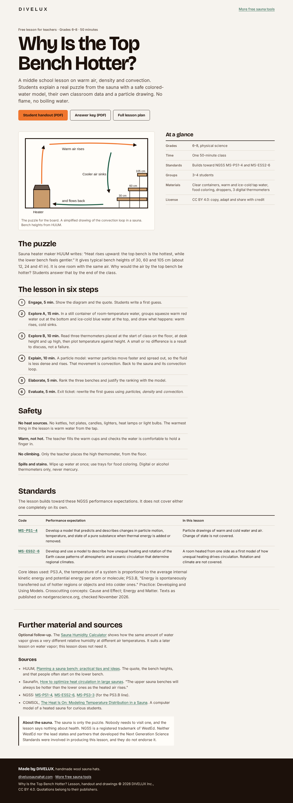
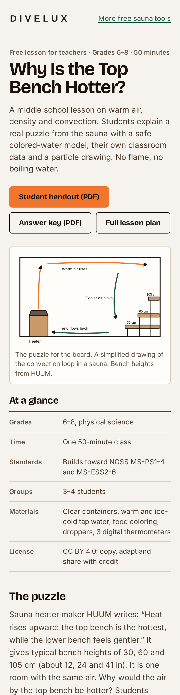

# Why Is the Top Bench Hotter? A Free Convection Lesson

A ready-to-teach middle school physical science lesson (grades 6–8, one 50-minute class) about warm air, density and convection. The puzzle comes from the sauna: the top bench is the hottest. Students explain it with a safe colored-water model, temperature readings at three heights in their own classroom, and a particle drawing.

No open flame, no boiling water, no special equipment, and nobody needs to visit a sauna.

Made by [DIVELUX](https://diveluxsaunahat.com), a small family brand in Irvine, California that makes handmade wool sauna hats. Web version: <https://divelux.github.io/sauna-physics-lesson/>

## What is in the folder

| File | What it is |
| --- | --- |
| `lesson-plan.md` | The full lesson: goals, NGSS alignment, materials, safety, the six steps with timings, differentiation, common misconceptions, answer key |
| `handout.pdf` | Student worksheet, 2 pages, US Letter. Built from `handout.html` |
| `answer-key.pdf` | Answer key, 1 page, US Letter. Built from `answer-key.html` |
| `index.html`, `style.css` | The teacher page with downloads |
| `assets/sauna-convection.svg` | The diagram for the board: heater, benches at 30, 60 and 105 cm, convection loop |
| `print.css` | Print styles for the handout and the key |
| `validate.py` | Checks the files, the PDF page counts, the NGSS quotes, links and page metadata |

To change the handout, edit `handout.html` and rebuild the PDFs with Playwright (the build script in the DIVELUX tools repository is `_build/spl-pdf.js`), or open the HTML file in a browser and print to PDF on Letter paper with background graphics on.

## The lesson in six steps

1. **Engage, 5 min.** The puzzle and a first guess.
2. **Explore A, 15 min.** Warm red water squeezed out at the bottom of a still container rises; ice-cold blue water squeezed out at the top sinks.
3. **Explore B, 10 min.** Three thermometers on the floor, at desk height and up high. Plot temperature against height. A small or no difference is a result to discuss.
4. **Explain, 10 min.** Particle model: warmer particles move faster and spread out, so the fluid is less dense and rises. Convection. The sauna's convection loop.
5. **Elaborate, 5 min.** Rank the benches and justify the ranking.
6. **Evaluate, 5 min.** Exit ticket with *particles*, *density* and *convection*.

## Standards

The lesson **builds toward** these NGSS performance expectations; it does not cover either one completely:

- **MS-PS1-4.** "Develop a model that predicts and describes changes in particle motion, temperature, and state of a pure substance when thermal energy is added or removed." (Change of state is not covered.)
- **MS-ESS2-6.** "Develop and use a model to describe how unequal heating and rotation of the Earth cause patterns of atmospheric and oceanic circulation that determine regional climates." (Only the unequal-heating part, at the scale of a room.)

Core ideas used: PS3.A (temperature and average kinetic energy) and PS3.B, "Energy is spontaneously transferred out of hotter regions or objects and into colder ones." Texts checked on nextgenscience.org in November 2026: [MS-PS1-4](https://www.nextgenscience.org/pe/ms-ps1-4-matter-and-its-interactions), [MS-ESS2-6](https://www.nextgenscience.org/pe/ms-ess2-6-earths-systems), [MS-PS3-3](https://www.nextgenscience.org/pe/ms-ps3-3-energy).

## Safety, in short

Warm tap water only, checked by the teacher; no kettles, hot plates, candles, heat lamps or light bulbs. Only the teacher places the high thermometer. Wipe up spills at once. Digital or alcohol thermometers, never mercury.

## Sources

- HUUM, [Planning a sauna bench: practical tips and ideas](https://huum.eu/planning-a-sauna-bench-practical-tips-and-ideas/): "Heat rises upward: the top bench is the hottest, while the lower bench feels gentler", the bench heights of 30, 60 and 105 cm, and that people often start on the lower bench.
- Saunafin, [How to optimize heat circulation in large saunas](https://www.saunafin.com/blog/how-to-optimize-heat-circulation-in-large-saunas/): "The upper sauna benches will always be hotter than the lower ones as the heated air rises."
- NGSS performance expectation pages linked above.
- Optional for students: COMSOL, [The Heat Is On: Modeling Temperature Distribution in a Sauna](https://www.comsol.com/blogs/the-heat-is-on-modeling-temperature-distribution-in-a-sauna).

The lesson makes no claim about how many degrees apart the benches are: published figures vary from room to room, so students reason from the model and from their own data.

**Further material (optional).** The [Sauna Humidity Calculator](https://divelux.github.io/sauna-humidity-calculator/) suits a later lesson on water vapor and relative humidity. This lesson does not need it.

## License

Lesson text, handout, answer key and diagram: CC BY 4.0, © 2026 DIVELUX Inc. (`LICENSE`). Copy, adapt, translate and share, including in paid course packs, with credit to "DIVELUX — diveluxsaunahat.com". Quotations belong to their publishers and are used with attribution.

NGSS is a registered trademark of WestEd. Neither WestEd nor the lead states and partners that developed the Next Generation Science Standards were involved in producing this lesson, and they do not endorse it.

More free sauna tools: <https://diveluxsaunahat.com/pages/sauna-tools>
